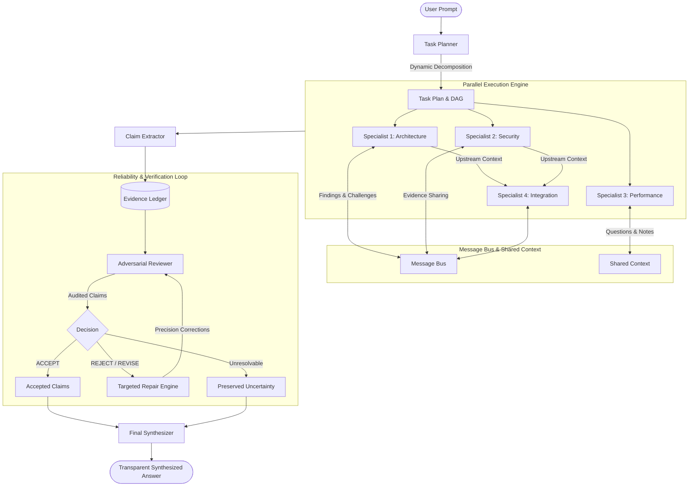

# MEDHA — Multi-Agent Evidence-Driven Architecture

[](https://www.python.org/)
[](https://ai.google.dev/)
[]()
[](https://modelcontextprotocol.io/)

**SEED Hackathon 2026** | **Problem Statement 02 — Chain of Command**  
*Topic-Independent, Dynamically Orchestrated Multi-Agent Intelligence with Adversarial Evidence Auditing*

---

## 1. Executive Summary

Traditional LLM workflows and naive multi-agent systems suffer from common failure modes:
1. **Echo Chambers / False Consensus**: Agents with static personas simply agree with one another or uncritically validate the primary prompt.
2. **Ungrounded Confidence**: High token probabilities and self-assessed confidence scores masquerade as factual evidence.
3. **Rigid Predefined Roles**: Fixed agent configurations struggle when encountering novel, multi-disciplinary problems.
4. **All-or-Nothing Rejection**: When an answer contains a single flaw, the entire output is either rejected or accepted with the flaw intact.

**MEDHA** solves these fundamental issues through a dynamic, evidence-grounded architecture:
- **Dynamic Specialist Creation**: Analyzes each user task to dynamically determine the exact domain expertise required and creates custom specialist agents on the fly.
- **Dependency-Aware Parallel Execution**: Automatically derives DAG dependencies, executing independent specialist subtasks concurrently while routing upstream findings to downstream specialists.
- **Structured Inter-Agent Message Bus**: Agents exchange formal findings, questions, evidence, and challenges across dedicated asynchronous inboxes.
- **Centralized Evidence Ledger**: Rigorously indexes every concrete assertion as an atomic claim tied to verified supporting evidence and source references.
- **Independent Adversarial Reviewer**: Audits claims using strict evidentiary criteria (challenging unverified leaps, superlatives, and hidden assumptions) rather than consensus.
- **Targeted Precision Repair**: Routes specific reviewer critiques back to the responsible specialist to narrow claims, declare explicit assumptions, or supply valid derivations.
- **Transparent Final Synthesis**: Assembles accepted findings, explicitly discloses excluded/rejected claims, highlights open caveats, and maintains full evidentiary traceability.
- **Full Model Context Protocol (MCP) Server**: Exposes MEDHA tools over the official MCP Python SDK for seamless integration into external agent environments.
- **Quantitative Benchmarking Suite**: Evaluates MEDHA against a single-agent baseline on reference criteria coverage, claim support rates, repair efficiency, and token economics.

---

## 2. System Architecture



---

## 3. Project Structure

```
MEDHA/
│
├── main.py                     # Interactive CLI and application entry point
├── requirements.txt            # Project dependencies
├── .env                        # Local configuration and credentials
├── .env.example                # Example environment configuration
├── .gitignore                  # Git ignore rules
│
├── config/
│   ├── settings.py             # Environment configuration and validation
│   └── logging_config.py       # Credential-redacting structured logging
│
├── core/
│   ├── llm_client.py           # Reusable async Gemini client with retries
│   ├── orchestrator.py         # Master workflow controller & execution manager
│   ├── planner.py              # Dynamic task planner & role decomposer
│   ├── agent_factory.py        # Dynamic agent creation & role routing
│   ├── execution_engine.py     # Dependency-aware concurrent executor
│   ├── task_manager.py         # Subtask state machine & dependency DAG
│   └── workflow.py             # Lifecycle stage tracker & audit trail
│
├── agents/
│   ├── base_agent.py           # Abstract agent base class
│   ├── specialist_agent.py     # Dynamic domain specialist implementation
│   ├── research_agent.py       # Literature and state-of-the-art specialist
│   ├── analyst_agent.py        # Quantitative & bottleneck analysis specialist
│   ├── technical_agent.py      # Engineering specification specialist
│   ├── critic_agent.py         # Vulnerability & edge-case specialist
│   ├── reviewer_agent.py       # Independent adversarial claim auditor
│   └── synthesizer_agent.py    # Evidence-grounded final synthesizer
│
├── communication/
│   ├── message.py              # Structured inter-agent message schema
│   ├── message_bus.py          # Asynchronous queue-based message broker
│   └── shared_context.py       # Thread-safe shared knowledge repository
│
├── verification/
│   ├── claim_extractor.py      # Discrete claim and assumption extractor
│   ├── evidence_ledger.py      # Centralized claim and evidence ledger
│   ├── claim_validator.py      # Heuristic validator for ungrounded claims
│   ├── adversarial_reviewer.py # Multi-criteria claim audit coordinator
│   └── repair_engine.py        # Iterative targeted claim repair engine
│
├── models/
│   ├── schemas.py              # Enums (TaskStatus, MessageType, ClaimStatus)
│   ├── task_models.py          # SubTask, TaskPlan, TaskResult schemas
│   ├── agent_models.py         # AgentConfig and AgentResponse schemas
│   └── verification_models.py  # Claim, Evidence, ReviewFeedback, Report
│
├── benchmark/
│   ├── baseline.py             # Single-agent direct baseline runner
│   ├── medha_runner.py         # MEDHA workflow benchmark runner
│   ├── evaluator.py            # Comparative evaluation engine
│   ├── metrics.py              # Statistical scoring and pricing metrics
│   ├── benchmark_dataset.json  # Curated multi-domain evaluation cases
│   ├── benchmark_report.json   # Exported quantitative JSON report
│   └── benchmark_results.csv   # Exported task-by-task CSV report
│
├── mcp_server/
│   ├── server.py               # Official Model Context Protocol (MCP) server
│   └── tools.py                # MCP tool implementations & execution cache
│
├── utils/
│   ├── helpers.py              # ID generators, JSON sanitizers, timestamps
│   ├── logger.py               # Structured ExecutionRecord and file logger
│   ├── retry.py                # Exponential backoff with jitter and error typing
│   └── token_tracker.py        # Thread-safe token consumption accumulator
│
├── tests/
│   ├── test_settings.py        # Configuration and validation tests
│   ├── test_llm_client.py      # Gemini client, retry, and token tracking tests
│   ├── test_agent_factory.py   # Dynamic agent creation and planning tests
│   ├── test_message_bus.py     # Message bus routing and concurrency tests
│   ├── test_verification.py    # Claim extraction, ledger, and auditing tests
│   ├── test_repair.py          # Targeted repair and re-review tests
│   ├── test_orchestrator.py    # End-to-end orchestration tests
│   ├── test_mcp.py             # MCP server tool execution tests
│   └── test_benchmark.py       # Benchmark evaluation and metric tests
│
└── logs/                       # Structured JSON execution traces
```

---

## 4. Setup and Installation

### Prerequisites
- Python 3.13+
- Active Google Gemini API Key

### Installation

1. **Activate the virtual environment**:
   ```powershell
   .\.venv\Scripts\Activate.ps1
   ```

2. **Install dependencies**:
   ```powershell
   pip install -r requirements.txt
   ```

3. **Configure credentials**:
   Ensure `.env` contains your Gemini API key:
   ```env
   LLM_PROVIDER=gemini
   GEMINI_API_KEY=your_gemini_api_key_here
   GEMINI_MODEL=gemini-3.8-flash
   APP_ENV=development
   LOG_LEVEL=INFO
   ```

---

## 5. Usage

### 1. Interactive Command Line Interface

Launch the interactive MEDHA assistant:
```powershell
python main.py
```

Enter your task prompt when requested:
```
Enter your task:
> Design a resilient multi-region database architecture with sub-10ms reads.
```

MEDHA will step through:
1. Dynamic planning and role selection
2. Parallel specialist agent execution
3. Inter-agent communication
4. Discrete claim extraction
5. Adversarial evidence auditing
6. Precision repair of flagged claims
7. Final synthesis with execution statistics

### 2. Direct Task Execution

Run a single task directly via CLI arguments:
```powershell
python main.py --task "Design a high-throughput financial ledger processing 100k TPS."
```

### 3. Single-Agent Baseline

Run a task using the un-orchestrated single-agent baseline for comparison:
```powershell
python main.py --baseline "Design a high-throughput financial ledger processing 100k TPS."
```

### 4. Quantitative Benchmark Suite

Run the full comparative benchmark suite across technical reasoning, software architecture, analytical reasoning, logical reasoning, and general knowledge:
```powershell
python main.py --benchmark
```

Output reports will be generated at:
- `benchmark/benchmark_report.json`
- `benchmark/benchmark_results.csv`

### 5. Model Context Protocol (MCP) Server

Start MEDHA as a standard MCP server over stdio for integration into Claude Code, Antigravity, or other MCP-compliant hosts:
```powershell
python main.py --mcp
```

Exposed MCP Tools:
- `run_medha_task(task: str, max_concurrency: int = 4, max_repair_iterations: int = 2)`
- `get_execution_status(execution_id: str)`
- `get_verification_report(execution_id: str)`
- `run_baseline(task: str, model: str = "")`

---

## 6. Verification and Auditing Principles

MEDHA adheres to uncompromising reliability standards:
- **No Agent Consensus as Proof**: Multiple agents agreeing on a claim does not constitute evidence. Only independent grounding or valid deductive derivation satisfies the auditor.
- **No Hallucinated Citations**: The system explicitly forbids inventing fake paper titles, URLs, or empirical statistics.
- **Superlative Detection**: The heuristic validator automatically flags claims containing unverified absolutes (`100% secure`, `zero latency`, `impossible to fail`).
- **Preserved Uncertainty**: If evidence is missing and a claim cannot be verified within the maximum repair cycles, it is marked `UNVERIFIABLE` and transparently disclosed as an unconfirmed hypothesis rather than forced as truth.
- **Traceable Synthesis**: Every factual recommendation in the final output is traceable back to accepted claims in the Evidence Ledger.

---

## 7. Automated Testing

MEDHA includes comprehensive automated unit and integration tests for every module. **All unit tests use mocked LLM responses** to ensure zero unwanted API charges and 100% reproducibility.

Run the test suite:
```powershell
python -m pytest tests/ -v
```

Test Coverage Summary:
- `tests/test_settings.py`: Configuration loading, validation, and boundary conditions.
- `tests/test_llm_client.py`: Async generation, Pydantic structured output, exponential backoff retries, error categorization (400, 401, 404, 429, 500), and token tracking.
- `tests/test_agent_factory.py`: Dynamic specialist creation, role-based subclass routing, and plan generation fallback.
- `tests/test_message_bus.py`: Queue-based inboxes, direct vs broadcast routing, thread-safe shared context, and dependency scheduling.
- `tests/test_verification.py`: Claim extraction, EvidenceLedger lifecycle, superlative heuristic detection, and adversarial claim reviews.
- `tests/test_repair.py`: Targeted repair loops, agent re-prompting, re-auditing, and uncertainty preservation.
- `tests/test_orchestrator.py`: Full end-to-end 6-stage lifecycle execution and error resilience.
- `tests/test_mcp.py`: MCP tool invocations, execution cache lookup, and schema serialization.
- `tests/test_benchmark.py`: Metric calculation, criteria evaluation, and report export.

---

## 8. License

Developed for the **SEED Hackathon 2026**. Built with Python 3.13 and the official Google GenAI SDK.

